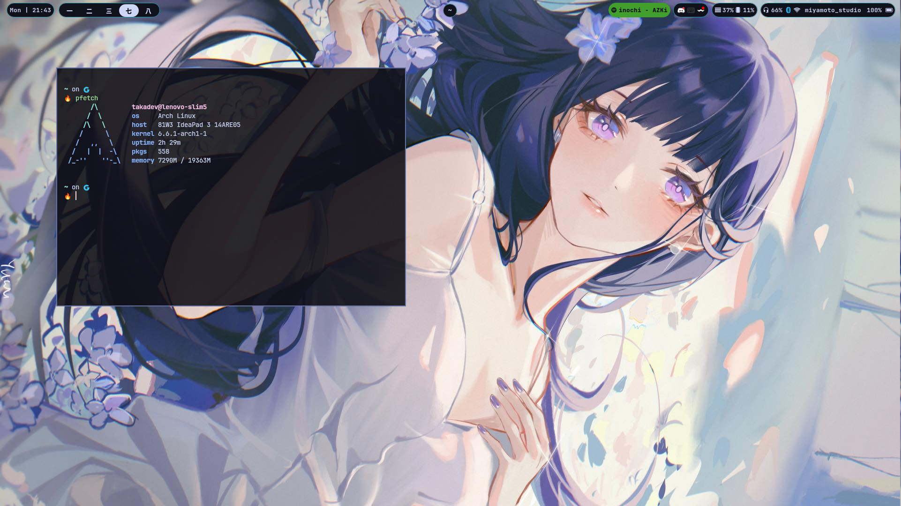

# OSセットアップ

## インストール方法

<details>
    <summary> 手順 </summary>

```bash
alias dots="/usr/bin/git --git-dir $HOME/.dotfiles/ --work-tree=$HOME"  
git clone --bare https://www.github.com/takadev15/dotfiles.git $HOME/.dotfiles
dots checkout  
dots config --local status.showUntrackedFiles no
```

</details>

## 使ったソフトウェア

* **OS** : Arch Linux
* **WM** : Sway
* **ステータスバー** : Waybar
* **テーマ** : Catpuccin Mocha with Papirus Dark Icon
* **シェル** : Zsh with Starship Prompt
* **ファイルマネージャー** : Xplr, Ranger (TUI) Thunar (GUI)
* **ターミナル** : Kitty, Foot + Tmux
* **エディター** : Neovim Nightly

## スクショ

* ricing


## 今からやってること

* [x] Swayをインストールする
  * [x] sddmからtuiにgreeterを変わってる
  * [x] swayidleのバッグを直す
* [ ] できればnixみたいにpersistence
* [ ] スクリプトについて
  * [ ] Bluetoothメニューのスクリプトを作る
  * [ ] スクショメニューを直す

## 注意！！

**if you want to copy my dotfiles please consider the software i use and plugis so the config can run smoothly**

**このドットファイルをコピーしたかったら使用ソフトウェアやプラグインなどを思考してください**
